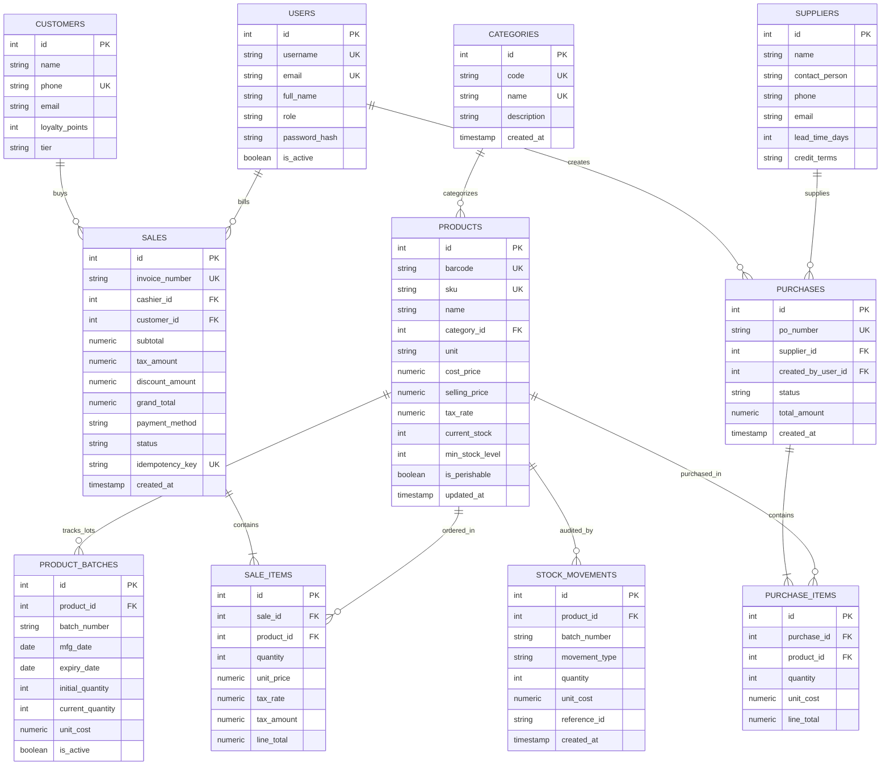

# Database Architecture & Schema Documentation
## SmartRetail AI — Data Tier Design & Specifications

---

## 1. Database Architecture Overview

SmartRetail AI utilizes an ACID-compliant relational database model managed via SQLAlchemy 2.0 ORM. The architecture supports two operational modes:
- **Primary Database (Production / Enterprise)**: PostgreSQL 14+ running on port 5432 with connection pooling, foreign key constraints, and transactional isolation.
- **Development Fallback Database**: SQLite 3 with Write-Ahead Logging (WAL) enabled, allowing zero-configuration local execution and offline developer workflows.

---

## 2. Entity-Relationship (ER) Diagram

---

## 3. Detailed Table Schema Definitions

### 3.1 `users` Table
Stores authenticated staff accounts and role assignments.
| Column | Type | Constraints | Description |
| :--- | :--- | :--- | :--- |
| `id` | `INTEGER` | `PRIMARY KEY`, Auto-increment | Internal unique user ID |
| `username` | `VARCHAR(50)` | `UNIQUE`, `NOT NULL`, Indexed | Staff login handle (e.g. `admin_rajesh`) |
| `email` | `VARCHAR(100)` | `UNIQUE`, `NOT NULL`, Indexed | Email address for staff communication |
| `full_name` | `VARCHAR(100)` | `NOT NULL` | Display name of the staff member |
| `role` | `VARCHAR(20)` | `NOT NULL`, Default: `'CASHIER'` | Role: `ADMIN`, `MANAGER`, `CASHIER` |
| `password_hash`| `VARCHAR(255)`| `NOT NULL` | Salted Bcrypt hash string (`$2b$12$...`) |
| `is_active` | `BOOLEAN` | `NOT NULL`, Default: `TRUE` | Soft deactivation flag |
| `created_at` | `TIMESTAMP` | `NOT NULL`, Default: `NOW()` | Record creation timestamp |
| `updated_at` | `TIMESTAMP` | `NOT NULL`, Default: `NOW()` | Record update timestamp |

### 3.2 `categories` Table
Organizes merchandise departments for inventory grouping and tax classification.
| Column | Type | Constraints | Description |
| :--- | :--- | :--- | :--- |
| `id` | `INTEGER` | `PRIMARY KEY`, Auto-increment | Internal department ID |
| `code` | `VARCHAR(30)` | `UNIQUE`, `NOT NULL`, Indexed | Standard department code (e.g. `CAT-DAIRY`) |
| `name` | `VARCHAR(100)`| `UNIQUE`, `NOT NULL`, Indexed | Category name (e.g. `Dairy & Chilled`) |
| `description` | `TEXT` | `NULLABLE` | Overview of category product scope |
| `created_at` | `TIMESTAMP` | `NOT NULL`, Default: `NOW()` | Creation timestamp |
| `updated_at` | `TIMESTAMP` | `NOT NULL`, Default: `NOW()` | Last modified timestamp |

### 3.3 `products` Table
Master catalog tracking retail SKUs, barcodes, pricing, and live inventory.
| Column | Type | Constraints | Description |
| :--- | :--- | :--- | :--- |
| `id` | `INTEGER` | `PRIMARY KEY`, Auto-increment | Internal unique product ID |
| `barcode` | `VARCHAR(50)` | `UNIQUE`, `NOT NULL`, Indexed | EAN-13, UPC-A, or internal barcode |
| `sku` | `VARCHAR(50)` | `UNIQUE`, `NULLABLE`, Indexed | Stock Keeping Unit code (e.g. `AML-TZ-1L`) |
| `name` | `VARCHAR(200)`| `NOT NULL`, Indexed | Commercial brand and product name |
| `description` | `TEXT` | `NULLABLE` | Packaging and ingredient details |
| `category_id` | `INTEGER` | `FOREIGN KEY (categories.id)` | Department classification reference |
| `unit` | `VARCHAR(20)` | `NOT NULL`, Default: `'Pack'` | Measurement unit (`Pack`, `Pouch`, `Kg`) |
| `cost_price` | `NUMERIC(10,2)`| `NOT NULL`, Default: `0.00` | Inward wholesale cost per unit |
| `selling_price`| `NUMERIC(10,2)`| `NOT NULL`, Default: `0.00` | Maximum Retail Price (MRP) |
| `tax_rate` | `NUMERIC(5,2)` | `NOT NULL`, Default: `5.00` | GST tax slab (0%, 5%, 12%, 18%) |
| `current_stock`| `INTEGER` | `NOT NULL`, Default: `0` | Live on-shelf physical quantity |
| `min_stock_level`|`INTEGER` | `NOT NULL`, Default: `20` | Reorder Point (ROP) threshold |
| `is_perishable`| `BOOLEAN` | `NOT NULL`, Default: `FALSE` | Triggers FEFO batch tracking |
| `created_at` | `TIMESTAMP` | `NOT NULL`, Default: `NOW()` | Creation timestamp |
| `updated_at` | `TIMESTAMP` | `NOT NULL`, Default: `NOW()` | Last modified timestamp |

### 3.4 `product_batches` Table
Granular lot-level tracking for perishable goods and expiry management.
| Column | Type | Constraints | Description |
| :--- | :--- | :--- | :--- |
| `id` | `INTEGER` | `PRIMARY KEY`, Auto-increment | Batch identifier |
| `product_id` | `INTEGER` | `FOREIGN KEY (products.id)` | Parent product reference |
| `batch_number`| `VARCHAR(50)` | `NOT NULL`, Indexed | Physical manufacturer lot code |
| `mfg_date` | `DATE` | `NULLABLE` | Production manufacturing date |
| `expiry_date` | `DATE` | `NOT NULL`, Indexed | Expiration date for FEFO compliance |
| `initial_quantity`| `INTEGER` | `NOT NULL` | Opening quantity received in lot |
| `current_quantity`| `INTEGER` | `NOT NULL` | Remaining sellable quantity in lot |
| `unit_cost` | `NUMERIC(10,2)`| `NOT NULL` | Wholesale unit cost for this specific lot |
| `is_active` | `BOOLEAN` | `NOT NULL`, Default: `TRUE` | Active lot flag |

### 3.5 `sales` & `sale_items` Tables
Stores completed POS checkout invoices, payment modes, and line item details.
- **`sales`**:
  - `invoice_number`: Unique invoice sequence (e.g., `INV-20261102-36257`).
  - `cashier_id`: Staff user who billed the transaction.
  - `customer_id`: Optional registered customer profile.
  - `subtotal`, `tax_amount`, `discount_amount`, `grand_total`: Monetary accounting totals.
  - `payment_method`: `CASH`, `UPI_QR`, `CREDIT_CARD`, `DEBIT_CARD`.
  - `status`: `COMPLETED`, `CANCELLED`.
  - `idempotency_key`: Client-supplied unique token preventing duplicate billing.
- **`sale_items`**:
  - `sale_id`: Reference to parent `sales` header.
  - `product_id`: Reference to purchased `products` item.
  - `quantity`: Quantity sold.
  - `unit_price`, `tax_rate`, `tax_amount`, `line_total`: Line-level financial breakdown.

### 3.6 `suppliers`, `purchases` & `purchase_items`
Manages replenishment procurement and Goods Receipt Note (GRN) inwarding.
- **`suppliers`**: Name, contact person, phone, email, `lead_time_days` (used in AI ROP formula), and `credit_terms`.
- **`purchases`**: `po_number` (e.g., `PO-20261102-9730C1`), `supplier_id`, `created_by_user_id`, `status` (`PENDING`, `RECEIVED`, `CANCELLED`), `total_amount`.
- **`purchase_items`**: `purchase_id`, `product_id`, `quantity`, `unit_cost`, `line_total`.

### 3.7 `stock_movements` Table (Immutable Audit Ledger)
Every inventory change writes an immutable audit record:
| Column | Type | Constraints | Description |
| :--- | :--- | :--- | :--- |
| `id` | `INTEGER` | `PRIMARY KEY`, Auto-increment | Ledger transaction ID |
| `product_id` | `INTEGER` | `FOREIGN KEY (products.id)` | Affected product |
| `batch_number`| `VARCHAR(50)` | `NULLABLE` | Associated batch lot |
| `movement_type`| `VARCHAR(30)` | `NOT NULL` | `POS_SALE`, `PURCHASE_RECEIPT`, `CUSTOMER_RETURN`, `STOCK_ADJUSTMENT` |
| `quantity` | `INTEGER` | `NOT NULL` | Negative for sales (-), positive for receipts (+) |
| `unit_cost` | `NUMERIC(10,2)`| `NULLABLE` | Valuation cost basis |
| `reference_id`| `VARCHAR(100)`| `NULLABLE` | Invoice Number, PO Number, or Return ID |
| `created_at` | `TIMESTAMP` | `NOT NULL`, Default: `NOW()` | Timestamp of movement |

---

## 4. Indexing Strategy & Concurrency

1. **Unique Indexes**:
   - `products.barcode`, `products.sku`
   - `sales.invoice_number`, `sales.idempotency_key`
   - `purchases.po_number`
   - `users.username`, `users.email`
   - `categories.code`, `categories.name`
   - `customers.phone`
2. **Performance Query Indexes**:
   - `sales.created_at` (Optimizes daily, weekly, and monthly date range report aggregation).
   - `product_batches.expiry_date` (Accelerates FEFO near-expiry scanning).
   - `stock_movements.product_id`, `stock_movements.created_at` (Optimizes ledger lookups).
3. **Transaction Isolation**:
   - Backend transactions operate under `READ COMMITTED` (PostgreSQL default), preventing dirty reads.
   - Checkout commits execute product stock checks and decrements within a single unified database transaction block (`db.commit()`), rolling back entirely on any validation or constraint error.

