# Final Capstone Demo & Presentation Script
## SmartRetail AI — 12-Step Supermarket Demonstration & Viva Guide

---

## Overview

This document provides a step-by-step walkthrough script for demonstrating **SmartRetail AI** during project evaluations, capstone vivas, or commercial demos. Each step specifies:
- **Actor & Credentials**: Who is performing the action.
- **What to Show**: Exact on-screen navigation, clicks, and visual elements to highlight.
- **What to Say**: Professional narrative explaining the engineering decisions and business value.

---

## Step-by-Step Demonstration Sequence

```mermaid
flowchart LR
    S1[1. Admin Login] --> S2[2. Add SKU]
    S2 --> S3[3. Inventory View]
    S3 --> S4[4. Record PO & Inward]
    S4 --> S5[5. Cashier Switch]
    S5 --> S6[6. Barcode Scan]
    S6 --> S7[7. Checkout]
    S7 --> S8[8. PDF Receipt]
    S8 --> S9[9. Stock Decrement]
    S9 --> S10[10. Reports & CSV/PDF]
    S10 --> S11[11. AI ROP Radar]
    S11 --> S12[12. Grounded Chatbot]
```

---

### Step 1: Login as Admin
- **Actor**: Administrator (`admin_rajesh` / `Admin@123`)
- **What to Show**:
  - Open `http://localhost:5173/login`.
  - Enter credentials and click **Sign In**.
  - Show the top-right profile badge displaying *"Rajesh Sharma (ADMIN)"*.
  - Show that all navigation tabs (including *User Management*) are visible.
- **What to Say**:
  > *"We begin by authenticating as an Administrator. The system verifies the user's salted Bcrypt password hash and returns a signed JSON Web Token (JWT). Role-Based Access Control assigns this account unrestricted administrative access, allowing user provisioning, catalog maintenance, and full financial auditing."*

---

### Step 2: Add a New Product to Catalog
- **Actor**: Administrator
- **What to Show**:
  - Navigate to the **Products** page.
  - Click **+ Add Product**.
  - Fill in the form:
    - Name: `Britannia Pure Magic Vanilla 120g`
    - Barcode: `8901063012999`
    - SKU: `BRT-MG-VAN`
    - Category: `Snacks & Packaged Food`
    - Unit: `Pack`
    - Cost Price: `₹32.00` | Selling Price (MRP): `₹45.00` | GST Rate: `18%`
    - Min Stock Level (ROP): `20`
    - Initial Stock: `0`
  - Click **Save Product**.
  - Show the new product appearing at the top of the product catalog table with stock badge indicating `0 Pack (Out of Stock)`.
- **What to Say**:
  > *"Here we add a newly introduced packaged food SKU. The system enforces unique EAN-13 barcodes and SKU codes, assigns standard GST tax brackets, and initializes physical stock to zero. This simulates introducing a new item to the supermarket catalog prior to receiving the first supplier delivery."*

---

### Step 3: Show Inventory Management & Valuation
- **Actor**: Administrator / Manager
- **What to Show**:
  - Click on the **Inventory** navigation tab.
  - Point to the inventory overview cards: Total Stock Units, Inventory Valuation at Cost (₹), and Retail MRP Valuation (₹).
  - Show the newly added product under the **Out of Stock** tab.
  - Highlight the **Stock Movement Ledger** showing opening stock entries.
- **What to Say**:
  > *"In the Inventory module, store managers get real-time valuation metrics of all warehouse and shelf merchandise. Notice that our newly created product is immediately flagged as Out of Stock, warning the procurement team that customer demand cannot be fulfilled without inwarding."*

---

### Step 4: Record a Purchase Order & Receive Goods (GRN)
- **Actor**: Manager (`mgr_priya` / `Manager@123` or Admin)
- **What to Show**:
  - Navigate to **Purchases**.
  - Click **+ New Purchase Order**.
  - Select Supplier: `Nestle India Limited` (or preferred distributor).
  - Select Product: `Britannia Pure Magic Vanilla 120g`.
  - Enter Quantity: `100` @ Unit Cost: `₹32.00` (Total: `₹3,200.00`).
  - Click **Issue Purchase Order** &rarr; Show status `PENDING`.
  - Click **Receive Goods (GRN)** on the order row.
  - Confirm the inwarding modal.
  - Show the PO status transition to `RECEIVED`.
  - Return to **Inventory** to show the product stock updated instantly from `0` to `100 Units`, and highlight the new immutable `StockMovement` row (`PURCHASE_RECEIPT`, `+100`).
- **What to Say**:
  > *"Now we simulate the procurement pipeline. The manager issues a formal Purchase Order. When the supplier truck arrives at the loading dock, the manager clicks 'Receive Goods'. Within an atomic database transaction, the purchase status changes to RECEIVED, physical warehouse inventory is incremented by exactly 100 units, and an immutable StockMovement audit record is created."*

---

### Step 5: Switch Role & Login as Cashier
- **Actor**: Cashier (`cashier_karan` / `Cashier@123`)
- **What to Show**:
  - Click **Sign Out** from the user avatar menu.
  - Log in with `cashier_karan` / `Cashier@123`.
  - Show that the sidebar navigation is automatically restricted: *User Management*, *Executive Reports*, and *AI Insights* are hidden or locked.
- **What to Say**:
  > *"To demonstrate role isolation, we log out and sign in as Cashier Karan. Notice how the user interface dynamically adapts: administrative tabs such as User Management and Financial Reports are completely removed from view, and attempts to invoke protected endpoints directly return HTTP 403 Forbidden."*

---

### Step 6: Scan or Search for a Product at POS
- **Actor**: Cashier
- **What to Show**:
  - Navigate to **POS Billing**.
  - Show the hardware barcode search input with auto-focus.
  - Click **Open Camera Scanner** to trigger the WebRTC video modal (or enter barcode `8901063012999` directly).
  - Show the camera view with the targeting crosshairs.
  - Upon scanning/entering the barcode, show the product instantly added to the cart: `Britannia Pure Magic Vanilla 120g` @ `₹45.00`.
- **What to Say**:
  > *"At the POS checkout counter, speed is critical. Our cashier interface supports both traditional USB laser barcode scanners and modern camera-based video recognition using HTML5 WebRTC. The moment the barcode is recognized, the backend validates available stock in under 10 milliseconds and adds the line item to the active bill."*

---

### Step 7: Complete a Sale with GST Calculation & Loyalty
- **Actor**: Cashier
- **What to Show**:
  - Increase the cart quantity from `1` to `4` units.
  - Enter customer phone number: `9880123456` (matches registered Gold customer Ananya Deshmukh).
  - Point to the live price calculation breakdown:
    - Subtotal: `₹152.54`
    - GST (18%): `₹27.46`
    - Grand Total: `₹180.00`
  - Select Payment Method: `UPI_QR` (or `CASH`).
  - Click **Complete Checkout (F9)**.
  - Show the green success toast displaying the generated invoice number (e.g., `#INV-20261102-XXXXX`).
- **What to Say**:
  > *"We adjust the quantity to 4 packs, link a registered loyalty customer, and choose UPI QR payment. The system breaks down the taxable value and GST dynamically. When the cashier clicks Complete Checkout, the transaction is submitted with an idempotency key to prevent accidental double-billing."*

---

### Step 8: Generate & Print Thermal PDF Invoice
- **Actor**: Cashier
- **What to Show**:
  - In the checkout confirmation dialog, click **Print Invoice (PDF)**.
  - Open the generated PDF in the browser preview.
  - Point out the supermarket header, invoice number, cashier ID, customer tier, itemized line entries with HSN/GST rates, and thermal receipt layout.
- **What to Say**:
  > *"SmartRetail AI embeds an on-the-fly PDF generation engine powered by ReportLab. It outputs vector-sharp, GST-compliant thermal invoices complete with customer loyalty points and payment confirmation."*

---

### Step 9: Verify Real-Time Stock Decrement & Audit Trail
- **Actor**: Store Manager
- **What to Show**:
  - Log back in as Manager or Admin.
  - Navigate to **Inventory**.
  - Search for `Britannia Pure Magic Vanilla 120g`.
  - Point to the updated stock: `96 Units` (was 100, exactly 4 sold).
  - Open the **Stock Movement Ledger** tab: show the new audit row with `Movement Type: POS_SALE`, `Quantity: -4`, and reference to the invoice number.
- **What to Say**:
  > *"Returning to the inventory module as a manager, we observe that the shelf stock decremented from 100 to 96 units in real time. The StockMovement ledger maintains an unbroken chain of custody showing exactly which invoice decremented the stock."*

---

### Step 10: Open Sales Reports & Export Data
- **Actor**: Store Manager
- **What to Show**:
  - Navigate to **Sales Reports**.
  - Select date range filter: **Today**.
  - Show the revenue summary card displaying today's total sales, completed orders, and average basket size.
  - Click **Export CSV** &rarr; open the downloaded spreadsheet showing itemized transactions.
  - Click **Download PDF Report** &rarr; open the styled executive summary PDF report.
- **What to Say**:
  > *"In the Sales Reports module, managers can audit revenue across daily, weekly, or custom date ranges. The platform supports streaming CSV exports for external spreadsheet reconciliation as well as executive PDF summaries for management meetings."*

---

### Step 11: Demonstrate AI Stock Replenishment Radar
- **Actor**: Store Manager
- **What to Show**:
  - Navigate to **AI Insights**.
  - Point to the **Engine Badge** in the top banner (e.g., `OPENAI_GPT` or `RULE_BASED_FALLBACK (Deterministic Decision Engine v1.0)`).
  - Review the **Replenishment Recommendations** table:
    - Explain the calculated Average Daily Sales (ADS), supplier lead time, and Reorder Point (ROP).
  - Review the **Near-Expiry FEFO Batches** alert section showing lots grouped into Critical (<7 days) and Warning (<=15 days).
- **What to Say**:
  > *"Here on the AI Insights dashboard, our decision-support engine takes over. Rather than relying on guesswork, it analyzes 30-day historical consumption velocity and supplier lead times to calculate empirical Reorder Points. Notice also the batch shelf-life monitor, which enforces First-Expiry-First-Out rules to curb perishable spoilage."*

---

### Step 12: Ask the Grounded AI Retail Assistant a Question
- **Actor**: Store Manager
- **What to Show**:
  - Click on the floating **AI Copilot** button in the bottom right corner (or use the AI Chat drawer on the AI Insights page).
  - Click or type the prompt:
    `"What were today's total sales?"`
  - Show the response returning accurate, verified figures matching the Sales Reports screen.
  - Ask another prompt:
    `"Which products are low in stock?"`
  - Show the response listing items requiring reorders with stock figures.
- **What to Say**:
  > *"Finally, we demonstrate the conversational retail assistant. Unlike generic chatbots that hallucinate numbers or execute unsafe SQL queries, our assistant is strictly grounded in predefined, parameterized database query functions. It interprets natural language intent, retrieves verified store figures, and presents actionable summaries while clearly attributing whether the response was synthesized by OpenAI GPT-4o-mini or the deterministic fallback engine."*

---

## Viva / Q&A Preparation Cheat Sheet

| Examiner Question | Ideal Response |
| :--- | :--- |
| **How do you prevent negative inventory during simultaneous checkouts?** | *"All checkout stock reductions occur inside a single atomic database transaction using SQLAlchemy under Read Committed isolation. If requested quantity exceeds available stock, the transaction immediately rolls back and returns HTTP 400 Bad Request with an insufficient stock notice."* |
| **What happens if the internet goes down or OpenAI credits expire?** | *"SmartRetail AI incorporates a two-phase fallback architecture. The backend automatically switches to our built-in Deterministic Rule Engine, computing exact ROPs and answering business queries without any external API dependencies, accompanied by a transparent UI fallback badge."* |
| **How are user passwords stored securely?** | *"Passwords are never stored in plaintext. They are salted and encrypted using the industry-standard Bcrypt algorithm with an adaptive cost factor of 12."* |
| **How is barcode scanning handled on mobile devices?** | *"We utilize the HTML5 WebRTC MediaDevices API through the `html5-qrcode` library, allowing standard smartphone cameras to scan 1D EAN-13 barcodes and 2D QR codes without native mobile app installation."* |

