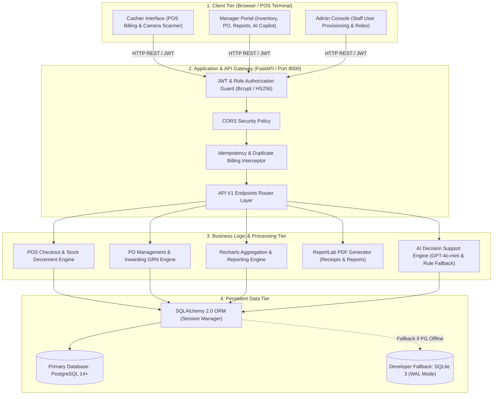
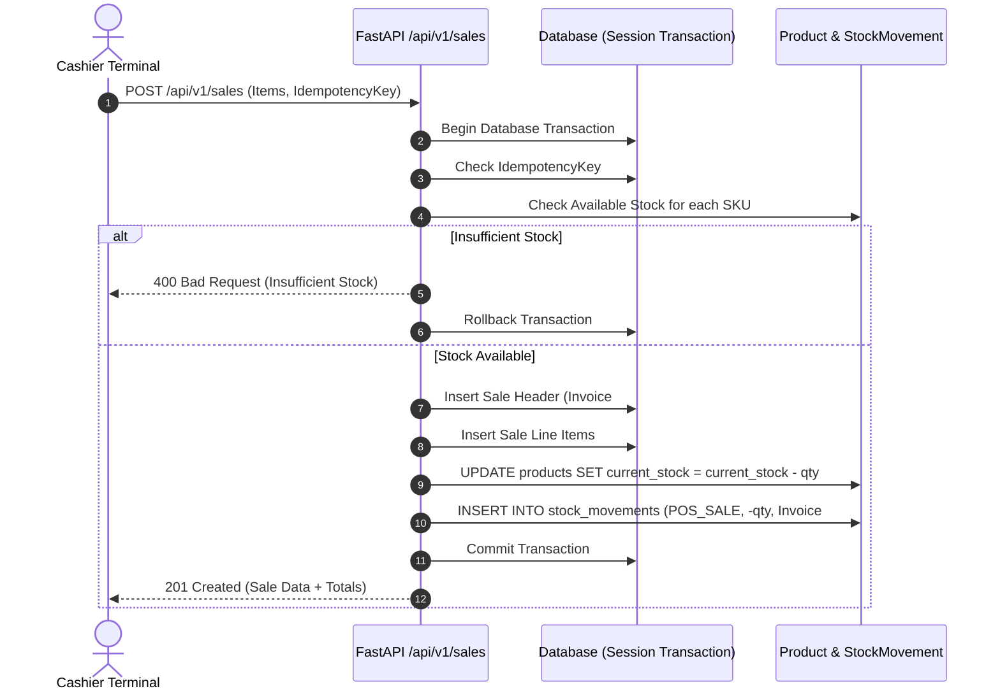
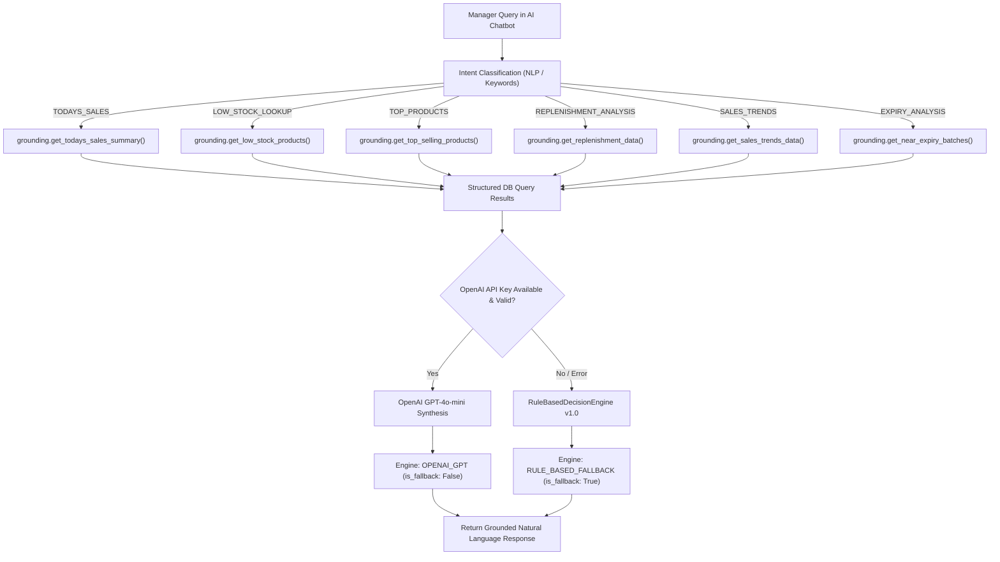

# System Architecture Documentation
## SmartRetail AI — Retail Inventory, POS Billing & Decision Support System

---

## 1. High-Level Architecture Overview

SmartRetail AI is structured according to a modern multi-tiered client-server architecture designed for high availability, low-latency transaction processing, and strict operational security.

---

## 2. Client Tier Architecture

The frontend is implemented as a React 19 Single Page Application (SPA) bundled with Vite:

### Key Client Subsystems
1. **Routing & Role Guarding (`App.jsx`, `ProtectedRoute.jsx`)**:
   - Manages client-side route navigation.
   - Restricts sensitive routes based on authenticated user role.
   - Redirects unauthorized roles (e.g., cashiers attempting to open `/users` or `/reports`) back to permitted operational views.
2. **State & Session Persistence (`AuthContext.jsx`)**:
   - Stores JWT access token, expiration, and user profile in browser storage.
   - Automatically injects `Authorization: Bearer <token>` into Axios headers for every backend call.
   - Clears credentials and navigates to `/login` upon receiving `401 Unauthorized` responses.
3. **Hardware & Camera Barcode Scanner (`BarcodeScannerModal.jsx`)**:
   - Utilizes `html5-qrcode` to interface directly with device camera video streams via HTML5 WebRTC.
   - Supports 1D EAN-13, UPC, Code 128, and 2D QR codes.
   - Emits an audible confirmation tone and auto-adds matching catalog items to the checkout cart.
   - Provides an auto-focus text input fallback for handheld USB/Bluetooth laser barcode scanners that emulate keyboard input.
4. **Data Visualization (`Dashboard.jsx`, `SalesReports.jsx`)**:
   - Renders interactive Area, Bar, and Line charts using Recharts.
   - Responsive breakpoints configured with Tailwind CSS v4.

---

## 3. Backend & API Gateway Tier

The backend is built with FastAPI running on the high-performance ASGI Uvicorn server:

### Gateway Security & Routing Pipeline
1. **CORS Middleware**: Explicitly whitelists allowed origins (e.g., `http://localhost:5173`) while allowing standard REST verbs (`GET`, `POST`, `PUT`, `DELETE`).
2. **Authentication Middleware (`app/api/deps.py`)**:
   - `get_current_user`: Decodes JWT payload, validates signature and expiration, and fetches user entity.
   - `get_current_manager`: Verifies user has `ADMIN` or `MANAGER` role.
   - `get_current_admin`: Verifies user has `ADMIN` role.
3. **Idempotency Interceptor**:
   - In `POST /api/v1/sales`, cashiers send an `idempotency_key` (UUID).
   - If a transaction with that key already exists, the backend returns the existing invoice without executing a second debit from inventory.

---

## 4. Transactional & Stock Management Architecture

All inventory modifications follow strict atomic consistency rules:

---

## 5. AI Subsystem Architecture

The AI subsystem incorporates a hybrid architecture combining an LLM synthesizer with a deterministic mathematical engine:

### Security Guarantees of the AI Architecture:
- **No Direct SQL Execution**: The AI model is strictly prohibited from formulating or executing arbitrary SQL strings. All database queries are pre-written in SQLAlchemy with explicit parameterization.
- **Role Isolation**: Only authenticated Managers and Admins can access AI insights or chat endpoints.
- **PII Protection**: Customer phone numbers and staff password hashes are excluded from AI grounding contexts.

